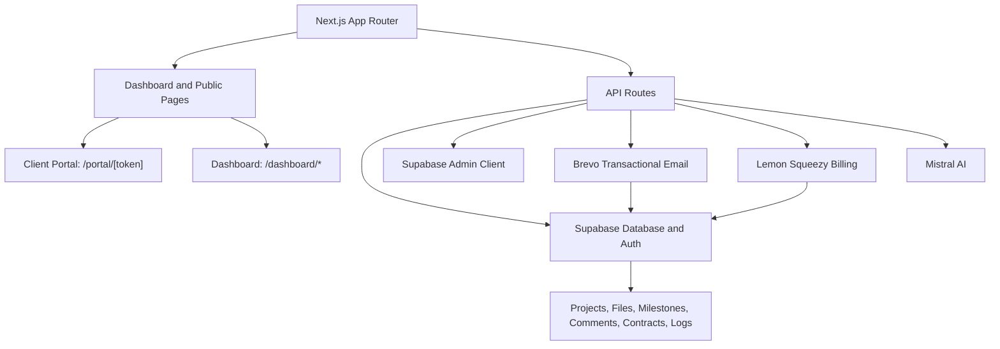

# ClientSpace

ClientSpace is a client delivery workspace for freelancers and small agencies. It combines project tracking, secure client portals, invoicing, contract handling, status updates, and AI-assisted drafting in a single Next.js app backed by Supabase, Brevo, and Lemon Squeezy.

**Live:** [clientspace-eta.vercel.app](https://clientspace-eta.vercel.app)

The main design goal is a low-friction client experience: clients do not need to create an account to review work, approve files, sign contracts, or leave feedback through their portal link.

## What This App Does
ClientSpace is built around a few concrete workflows:

1. Freelancers create and manage projects from the dashboard.
2. Clients access project-specific portals through a secure tokenized URL.
3. Files, comments, invoices, contracts, milestones, and activity logs stay attached to the same project record.
4. AI endpoints help draft invoices, proposals, and status updates for paid plans.
5. Billing upgrades are handled through Lemon Squeezy, with subscription state mirrored into Supabase.
6. Automated email notifications keep both sides informed when project events happen.

## System Overview


## Core Engineering Principles

The codebase follows a few practical rules rather than cosmetic ones:

- Keep privileged operations server-side. Admin database access is isolated behind service-role clients.
- Use route-scoped actions. Every mutation has a specific API endpoint and a clear failure mode.
- Gate expensive AI features by plan. The Pro plan is required for invoice, proposal, and status generation.
- Treat the client portal as a first-class product surface, not an afterthought.
- Record meaningful events in logs so project activity is auditable.
- Prefer explicit validation and defensive defaults over hidden assumptions.
- Build for production ergonomics: clean redirects, typed routes, safe webhook handling, and environment-driven configuration.

## Main Product Surfaces
### Dashboard

The authenticated workspace lives under `/dashboard` and includes project management, billing, settings, admin views, and project creation flows.

### Client Portal

The public project portal lives at `/portal/[token]`. It loads project data, milestones, files, comments, invoices, contracts, and logs from a single tokenized route.

### Public Pages

The app also includes marketing and legal pages such as the homepage, audience pages, login and onboarding flows, privacy policy, refunds, and terms.

## API Surface
The backend is intentionally small and action-focused:

- `GET /api/portal?token=...` fetches the full portal view for a project.
- `POST /api/portal` performs client actions such as adding comments, approving files, signing contracts, and submitting feedback.
- `POST /api/notifications` sends email notifications for comments, invoices, file approvals, status changes, payments, and signed contracts.
- `POST /api/checkout` creates a Lemon Squeezy checkout session for plan upgrades.
- `POST /api/webhooks/lemonsqueezy` updates subscription state after billing events.
- `POST /api/ai/invoice` generates structured invoice line items.
- `POST /api/ai/proposal` drafts a project proposal in Markdown.
- `POST /api/ai/status-update` drafts a client-facing progress update email.

## Data And Security Model
Supabase is the source of truth for users, projects, files, milestones, comments, contracts, invoices, and logs.

- Authenticated routes use Supabase session state.
- Admin and webhook routes use a service-role client only on the server.
- Client portal access is token-based to reduce friction while still keeping project data scoped to one project.
- Lemon Squeezy webhook payloads are validated with an HMAC signature check before subscription updates are applied.
- Portal mutations are written back into project-specific tables and logged as discrete events.

## AI-Driven Actions
AI features are not generic chat. They are task-specific tools that produce usable work output:

- Invoice drafting turns plain-language work notes into structured line items.
- Proposal drafting turns project scope into a client-ready Markdown proposal.
- Status updates turn recent project activity into a polished email update.

If `MISTRAL_API_KEY` is missing, the routes return deterministic fallback content so the app can still be exercised during local setup.

## Repository Structure
```text
app/                Next.js routes, pages, layouts, and API handlers
components/         UI, dashboard, and project-specific components
lib/                Shared helpers for Supabase, email, compression, logging, and utilities
public/             Static files, sitemap, and robots configuration
supabase/           SQL schema, RLS fixes, and admin security scripts
```

## Getting Started
### Prerequisites

- Node.js 18 or newer
- npm
- A Supabase project
- Brevo account for transactional email
- Lemon Squeezy store and variant for billing
- Mistral API key if you want live AI generation

### Install

```bash
git clone https://github.com/sxhaakee/clientspace.git
cd clientspace
npm install
```

### Environment Variables

Create a `.env.local` file in the project root.

```env
NEXT_PUBLIC_APP_URL=http://localhost:3000
NEXT_PUBLIC_SUPABASE_URL=your_supabase_url
NEXT_PUBLIC_SUPABASE_ANON_KEY=your_supabase_anon_key
SUPABASE_SERVICE_ROLE_KEY=your_supabase_service_role_key

BREVO_API_KEY=your_brevo_api_key
BREVO_SENDER_EMAIL=notifications@clientspace.app
BREVO_SENDER_NAME=ClientSpace

LEMONSQUEZY_API_KEY=your_lemonsqueezy_api_key
LEMONSQUEZY_STORE_ID=your_store_id
LEMONSQUEZY_VARIANT_ID=your_variant_id
LEMONSQUEZY_WEBHOOK_SECRET=your_webhook_secret

MISTRAL_API_KEY=your_mistral_api_key
NEXT_PUBLIC_GOOGLE_SITE_VERIFICATION=optional_verification_token
```

### Run Locally

```bash
npm run dev
```

### Production Build

```bash
npm run build
```

### Start The Production Server

```bash
npm run start
```

### Lint

```bash
npm run lint
```

## Operational Actions
Use this as the day-to-day checklist for working on the app:

1. Configure Supabase schema and run the SQL files in `supabase/` before testing portal flows.
2. Set the env vars above before testing billing, notifications, or AI routes.
3. Verify `/dashboard` after authentication to confirm middleware and session state are working.
4. Verify `/portal/[token]` with a real project token to test comment, file approval, contract signing, and feedback submission.
5. Trigger notification events to confirm Brevo email templates and Supabase lookups are wired correctly.
6. Exercise the billing path with Lemon Squeezy sandbox data before going live.
7. Test AI routes with and without `MISTRAL_API_KEY` to confirm fallback behavior.
8. Confirm the app builds cleanly before merging changes.

## Deployment Notes
- Set `NEXT_PUBLIC_APP_URL` to the canonical production origin.
- Use a real Supabase service-role key only on the server.
- Register the Lemon Squeezy webhook endpoint in production and keep the webhook secret in the deployment environment.
- Configure Brevo sender details so transactional mail comes from the correct identity.
- If you use Google site verification, wire the token through `NEXT_PUBLIC_GOOGLE_SITE_VERIFICATION`.

## Development Notes
- The app router structure is organized by product surface, not by technical layer.
- API routes are intentionally narrow and map to user actions.
- `lib/` contains the shared primitives used across the app, including Supabase clients and email helpers.
- `supabase/` contains the SQL artifacts needed to keep the backend schema and policies aligned with the app.

## Suggested Validation Flow
When changing application code, run the smallest check that proves the slice still works:

1. Start with `npm run lint` for fast feedback.
2. Run `npm run build` before release or when touching route handlers, auth, or server logic.
3. Test the specific workflow you changed, such as portal data loading, a webhook payload, or an AI route.
